<div align="center">

# Kapra Planner

**Plan it. Try it. Get it stitched.**
An AI stylist for Pakistani fashion with virtual try-on, ranked local tailors, Stripe payments, live order tracking and chat.

[**Live app**](https://kapra-planner-app.alternatefutures.ai) ·
CS-301 Full Stack Web Development · Air University Islamabad · Fall 2026 ·
Deployed on **Alternate Clouds**

<br>


-635BFF?style=for-the-badge&logo=stripe&logoColor=white)


<br>

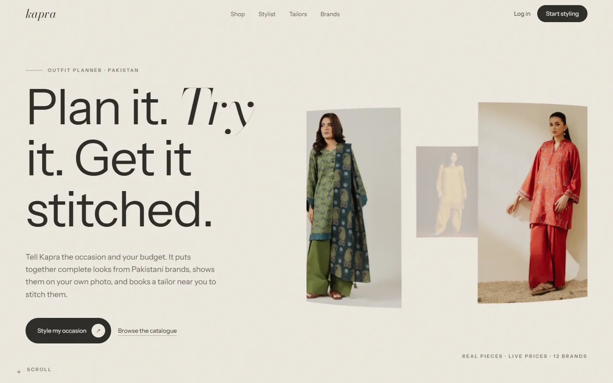

</div>

---

## Contents

1. [The problem](#the-problem)
2. [What Kapra does](#what-kapra-does)
3. [Try it](#try-it)
4. [Screens](#screens)
5. [System architecture](#system-architecture)
6. [How the main features work](#how-the-main-features-work)
7. [Bookings and orders as state machines](#bookings-and-orders-as-state-machines)
8. [How Kapra picks the best tailor](#how-kapra-picks-the-best-tailor)
9. [Data model](#data-model)
10. [Security](#security)
11. [API overview](#api-overview)
12. [Tech stack](#tech-stack)
13. [Project structure](#project-structure)
14. [Run it locally](#run-it-locally)
15. [Testing and CI](#testing-and-ci)
16. [Deployment on Alternate Clouds](#deployment-on-alternate-clouds)
17. [Design system](#design-system)
18. [Limits and what's next](#limits-and-whats-next)
19. [Team](#team)

---

## The problem

Getting an outfit ready for an occasion in Pakistan usually means four separate jobs: scrolling a dozen brand websites, guessing whether a piece will suit you, finding a tailor you can trust, and then chasing them on WhatsApp for updates. Brand sites cannot style across brands, tailors are found by word of mouth, and nothing connects the outfit you picked to the person stitching it.

## What Kapra does

Kapra puts the whole journey in one place, for four kinds of users.

| | Role | What they get |
|:-:|---|---|
| 🛍️ | **Customer** | **AI stylist** that builds 2–3 complete looks from real, in-stock pieces in their size and budget · **virtual try-on** on their own photo · saved looks with piece swaps · **tailor map** ranked by reviews · **booking with Stripe**, live tracking and chat · checkout with partner brands |
| ✂️ | **Tailor** | Shop on the map with a pin, priced services and a gallery · paid booking requests with the customer's measurements and the look to stitch · accept, decline, progress, chat · reply to reviews · their **Kapra score** explained |
| 🏷️ | **Brand** | Catalogue synced every night from their shop feed · hide pieces, stock per size, hand-listed pieces · store locations on the map · orders with tracking numbers · 30-day sales and interest analytics |
| 🛡️ | **Admin** | Platform stats · approve or suspend accounts · link brand accounts to their brands · run the catalogue sync · moderate reviews flagged by the language model |

**By the numbers:** about **5,000 products** from **12 Pakistani brands**, **19 tailor shops** across Islamabad, Rawalpindi, Lahore and Karachi, **368 reviews** scored by a pre-trained language model, **72 automated tests**.

---

## Try it

> **Live:** **https://kapra-planner-app.alternatefutures.ai**

| Role | Email | Password |
|---|---|---|
| 🛍️ Customer | `customer@kapra.test` | `KapraDemo1` |
| ✂️ Tailor | `tailor@kapra.test` | `KapraDemo1` |
| 🏷️ Brand (manages Limelight) | `brand@kapra.test` | `KapraDemo1` |
| 🛡️ Admin | `admin@kapra.test` | ask the team |

> [!TIP]
> Payments run in **Stripe test mode**. Pay with card **`4242 4242 4242 4242`**, any future expiry date and any CVC. No real money moves.

**A two-minute walkthrough**

1. Log in as the **customer** → **AI stylist** → pick *Wedding*, Rs 15,000, a colour or two → **Style me**.
2. **Save** a look, then press **Try on** and upload a full-length photo.
3. Press **Get it stitched** → choose a tailor on the map → book and pay with the test card.
4. Log in as the **tailor** in another browser → accept the booking → **Start stitching** → **Mark ready**. The customer's timeline, notifications and chat update live.
5. Back as the customer → **I received it** → leave a review. The tailor's score updates immediately.

---

## Screens

<table>
  <tr>
    <td width="50%">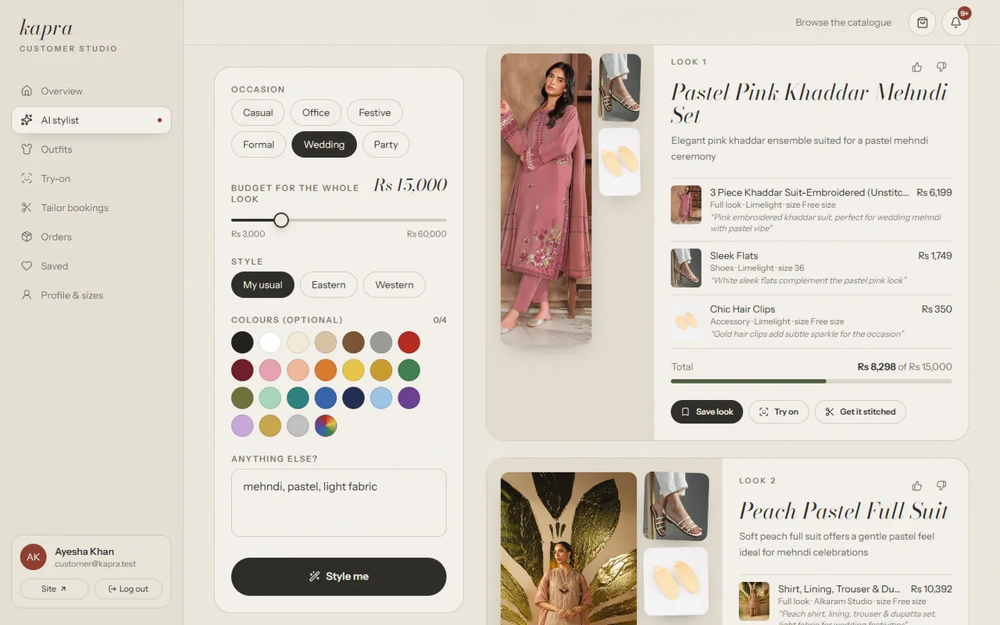<br><sub><b>AI stylist</b>: complete looks as mood boards, with reasons and a budget meter</sub></td>
    <td width="50%">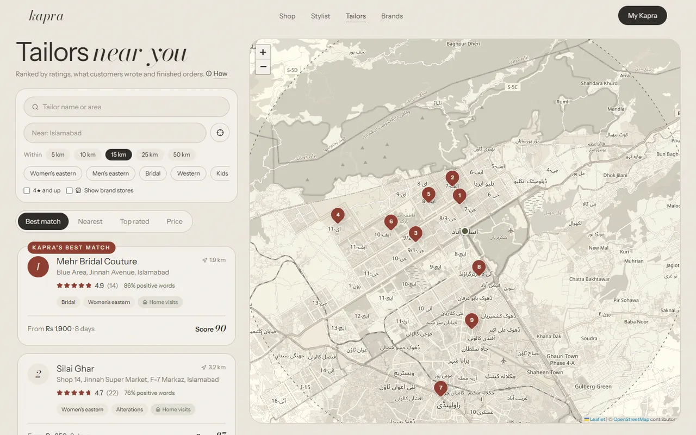<br><sub><b>Tailor map</b>: ranked by the Kapra score within the radius you choose</sub></td>
  </tr>
  <tr>
    <td>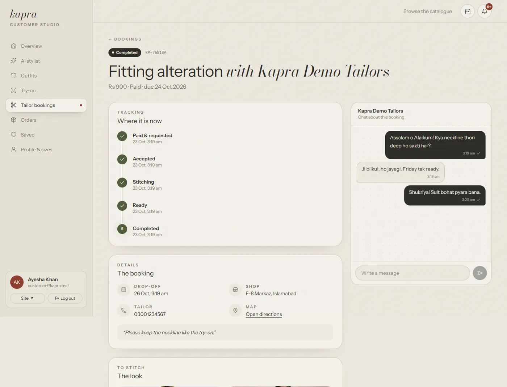<br><sub><b>Booking</b>: tracking timeline, live chat with read ticks, the try-on to stitch</sub></td>
    <td>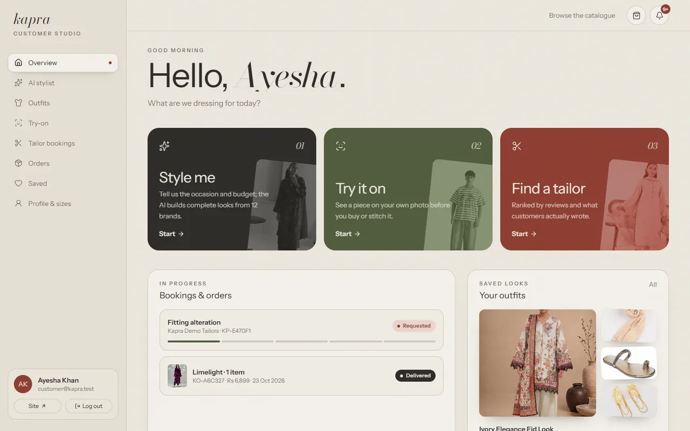<br><sub><b>Customer studio</b>: 3D tilt cards, live booking and order progress</sub></td>
  </tr>
  <tr>
    <td>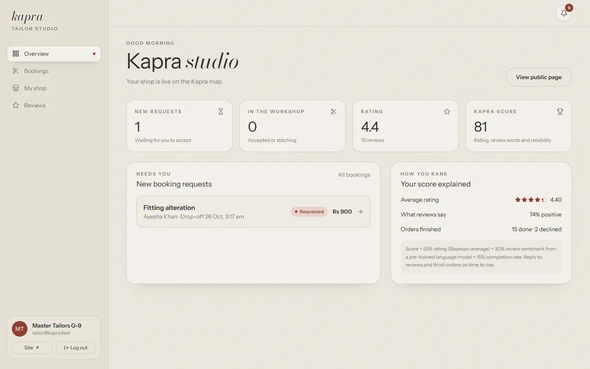<br><sub><b>Tailor studio</b>: new requests and how the score is built</sub></td>
    <td>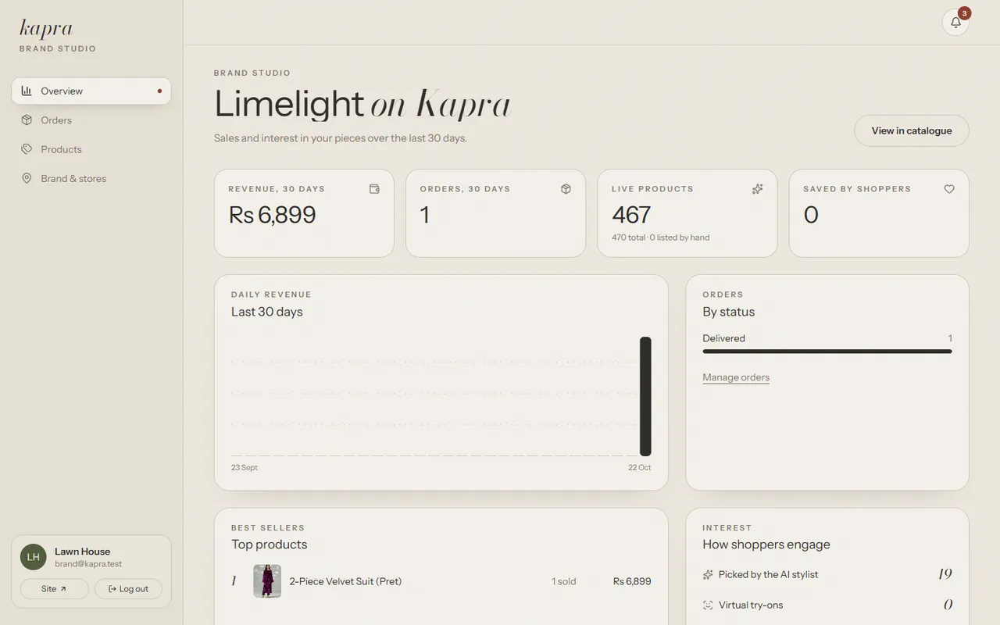<br><sub><b>Brand studio</b>: revenue, orders, stylist picks and try-ons</sub></td>
  </tr>
</table>

---

## System architecture

Colour key: 🟫 **browser** · 🟩 **our server** · 🟦 **data** · 🟧 **AI services** · 🟪 **payments and maps** · ⬛ **scheduled jobs**

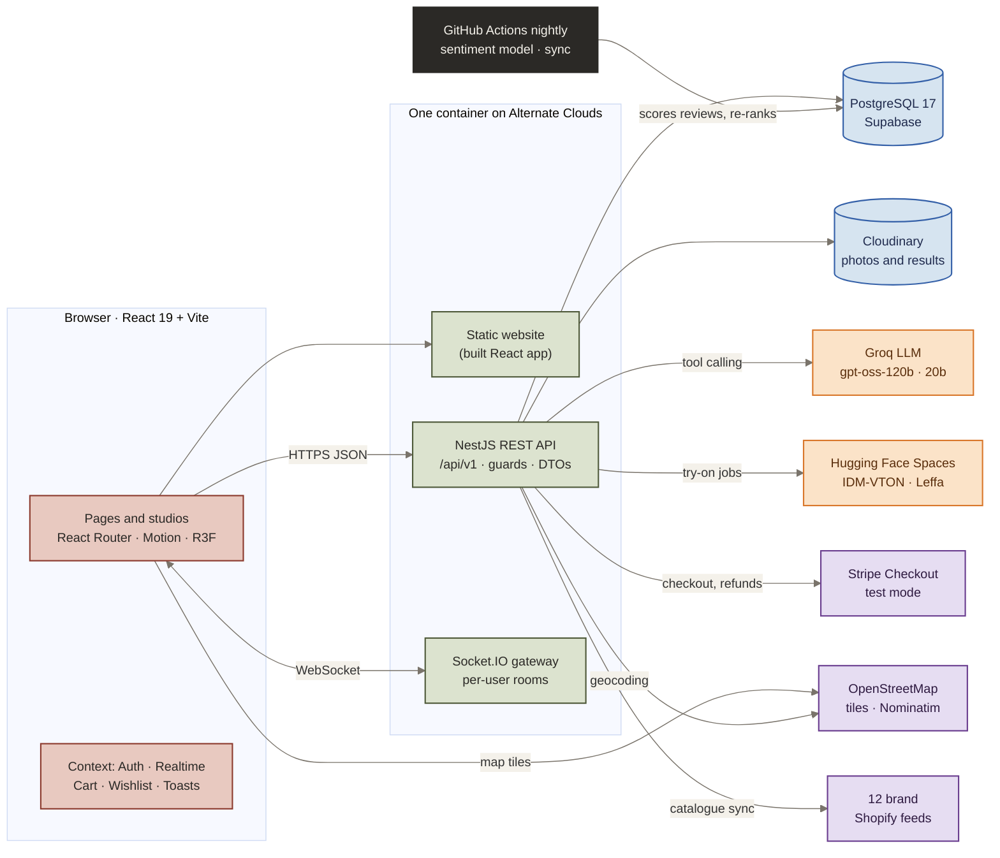

**Why it is built this way**

- **One container, one address.** The NestJS server also serves the built website, so there is no cross-site setup and Socket.IO shares the same origin.
- **Heavy AI never runs in the web server.** The stylist runs on Groq, try-on on Hugging Face GPUs, and review sentiment in a nightly GitHub Actions job. The server stays small (1 CPU, 1 GB).
- **Every outside service sits behind an interface** (`LLM_CLIENT`, `TRY_ON_PROVIDERS`, `PAYMENT_GATEWAY`, `IMAGE_STORAGE`, `GEOCODER`, `EMAIL_SENDER`), injected by NestJS. Swapping a provider changes one module, not the features.

### Backend modules

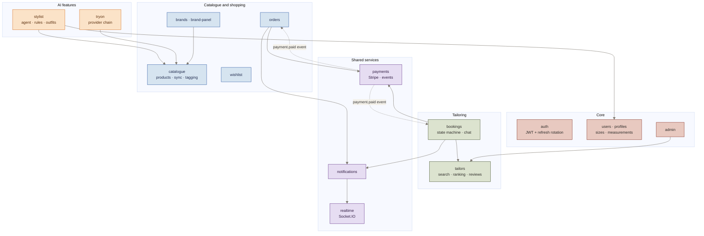

Payments know nothing about bookings or orders. When Stripe confirms a payment, `PaymentsService` publishes a `payment.paid` event and the owning module reacts (observer pattern), so bookings and product orders share one payment flow.

---

## How the main features work

### 1. AI stylist (tool-calling agent with a safety net)

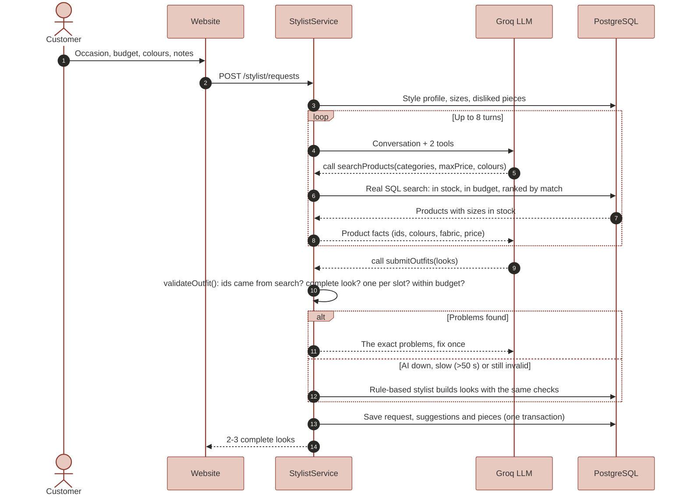

- The model **can only pick products our search returned**; anything else is rejected and sent back as an error, so it cannot invent items.
- `KeyPool` rotates four Groq keys and rests a key that hits a rate limit.
- Disliked looks are remembered and those pieces are left out next time.

### 2. Virtual try-on (background job + provider chain)

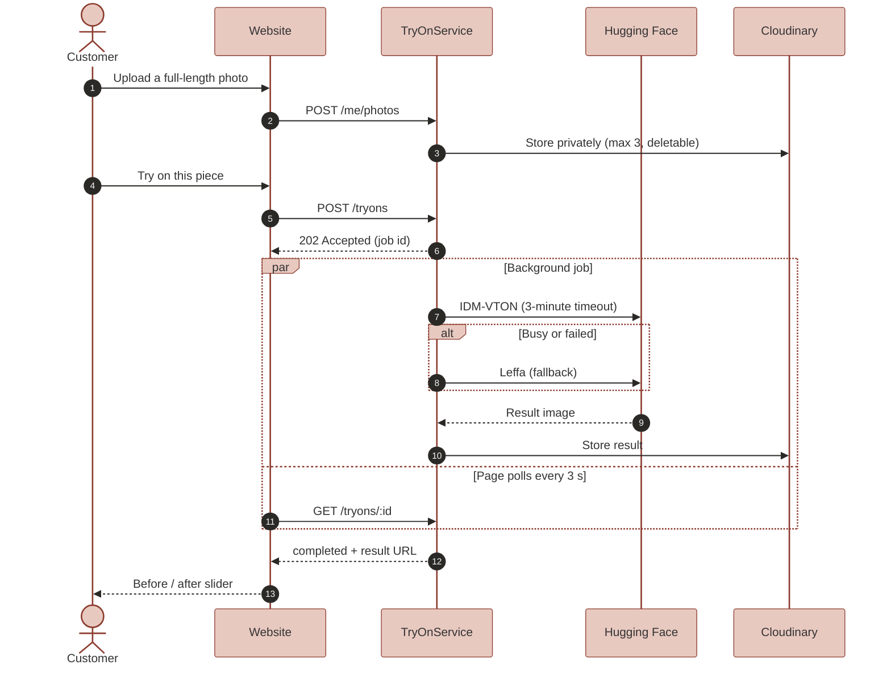

Results are cached per photo and piece, and each customer runs one job at a time because the free GPUs are shared.

### 3. Booking a tailor and paying with Stripe

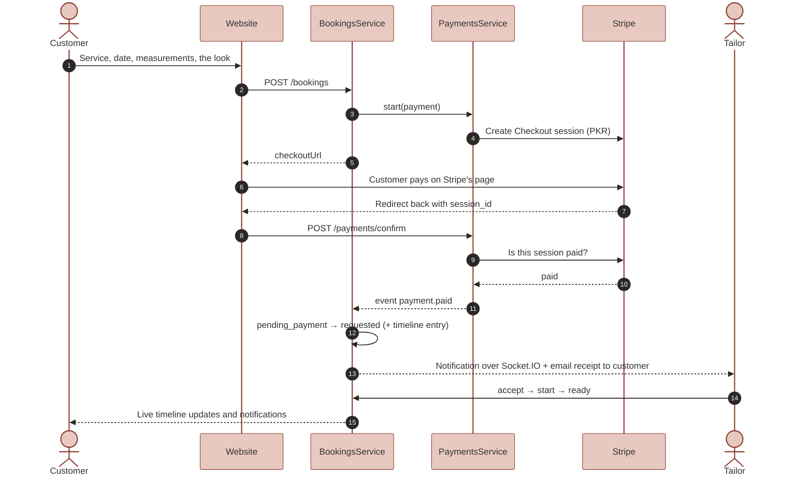

- Card details never reach our server; customers pay on Stripe's hosted page.
- Payment is confirmed by **asking Stripe** on return, and by **signed webhooks** once a webhook secret is set. Both use one conditional update, so a payment is processed exactly once.
- Declines and cancellations after payment are **refunded automatically**.

### 4. Live updates

Every browser opens one Socket.IO connection, authenticated with the same access token as the REST API. The server puts it in a private room `user:<id>` and pushes **notifications, chat messages and status changes** there. Clients never choose rooms, so nobody can listen to someone else's booking.

---

## Bookings and orders as state machines

Every status change goes through one pure function, `nextStatus(current, action, actor)`. An action is allowed only from the right status **and** by the right person, and the database update only succeeds if nobody changed the booking in between (no double clicks).

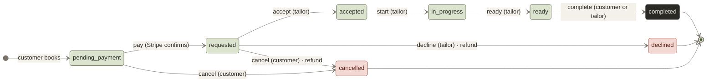

Product orders follow the same idea: `pending_payment → paid → shipped (tracking number) → delivered`, with cancellation and refund before shipping.

---

## How Kapra picks the best tailor

The instructor asked for tailors to be filtered by ratings and reviews, with a **pre-trained model** choosing the best. Every tailor gets a score from 0 to 100:

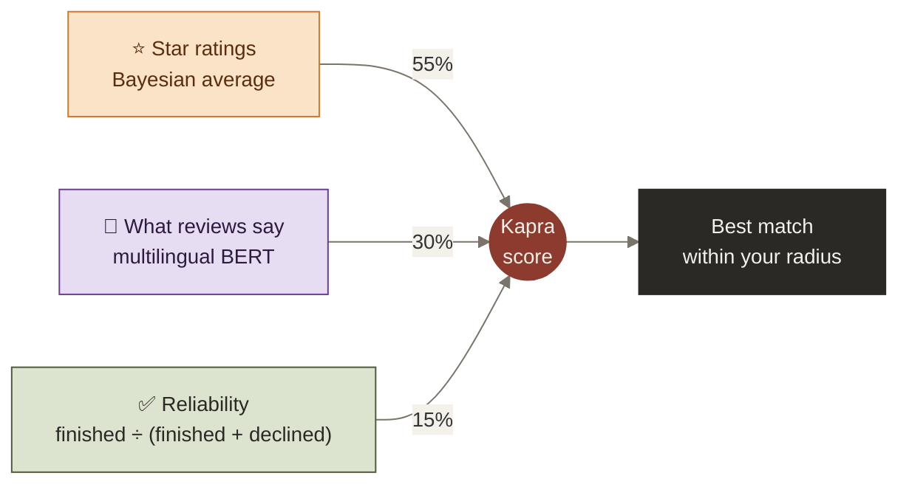

| Part | How it is calculated | Why |
|---|---|---|
| **Rating (55%)** | `(5 × global mean + sum of ratings) ÷ (5 + number of ratings)` | One 5-star review should not beat fifty 4.8-star reviews |
| **Sentiment (30%)** | [`nlptown/bert-base-multilingual-uncased-sentiment`](https://huggingface.co/nlptown/bert-base-multilingual-uncased-sentiment) reads each comment (English, Urdu or Roman Urdu) and gives a probability for 1–5 stars; the expected stars, scaled to 0–1 | Catches complaints hidden behind generous star ratings |
| **Reliability (15%)** | Finished bookings ÷ (finished + declined), assumed 0.9 until there are 3 bookings | Rewards tailors who follow through |

The model runs in a nightly GitHub Actions job (`npm run job:reviews`) with Transformers.js, not in the web server, because it is about 170 MB. Admins can hide abusive reviews; the ranking recalculates at once. **Limitation:** Roman Urdu is scored less reliably than English and Urdu script, which is why sentiment is only 30% of the score.

---

## Data model

The main tables (33 in total, every one with row level security enabled in Supabase):

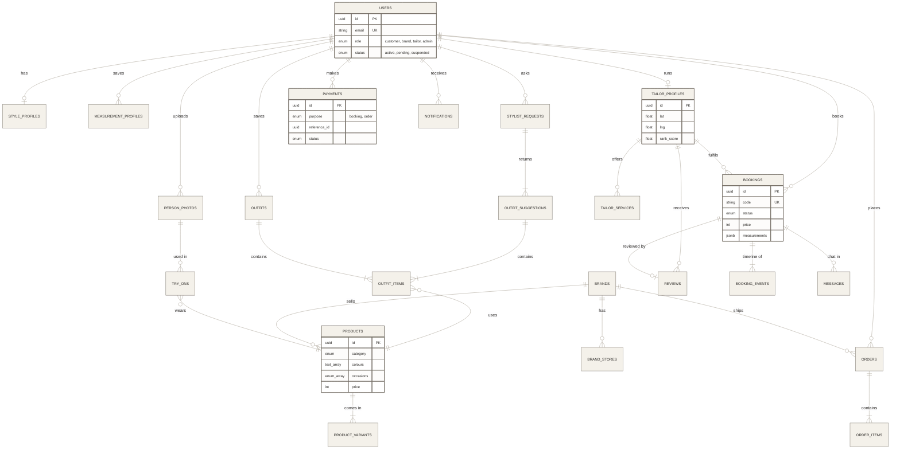

Schema changes only happen through **TypeORM migrations** (`synchronize` is off). Prices are copied into bookings and orders when they are made, so later price changes never alter a past order.

---

## Security

| Area | What Kapra does |
|---|---|
| 🔑 **Passwords** | bcrypt (cost 12); a dummy hash is checked for unknown emails so response time does not reveal accounts; 5 failed logins lock the account for 15 minutes |
| 🎫 **Sessions** | 15-minute JWT access token kept only in memory; refresh tokens are random, stored hashed, **single use** and rotated; reusing an old one signs that user out everywhere |
| 🚦 **Access** | Global guards in order: rate limiter → JWT → role check. Every `:id` route checks the record belongs to the caller |
| 📥 **Input** | Every request body and query is validated by a DTO (unknown fields rejected); uploads checked by real file content, max 8 MB |
| 💳 **Payments** | Cards handled only by Stripe; amounts calculated on the server; webhook signatures verified and events processed once |
| 🗄️ **Database** | Row level security on every table, so Supabase's public REST API exposes nothing |
| 🧱 **Headers** | Helmet with a Content Security Policy, CORS limited to the site, request IDs on every log line |
| 🤫 **Secrets** | Only in `api/.env` locally and in the service settings in production; never in the repo or the image |

---

## API overview

REST under `/api/v1`, documented with **Swagger at `/api/docs`**.

| Area | Main endpoints |
|---|---|
| Auth | `POST /auth/register` · `/auth/login` · `/auth/refresh` · `/auth/logout` · `GET /auth/me` |
| Profile | `PATCH /me` · `GET/PUT /me/style-profile` · `CRUD /me/measurements` · `/me/wishlist` · `/me/photos` |
| Catalogue | `GET /products` (filters, search, paging) · `/products/:id` · `/products/:id/similar` · `/products/facets` · `/brands` · `/brands/stores` |
| Stylist | `POST /stylist/requests` · `GET /stylist/requests` · `POST /stylist/suggestions/:id/save` · `PUT .../feedback` · `/outfits` (rename, swap a piece, alternatives) |
| Try-on | `POST /tryons` (202) · `GET /tryons/:id` · `GET /tryons` · `DELETE /tryons/:id` |
| Tailors | `GET /tailors?lat&lng&radiusKm&sort` · `/tailors/:slug` · `/tailors/:slug/reviews` · `/geo/search` |
| Tailor panel | `GET/PUT /tailor/profile` · gallery · `CRUD /tailor/services` · `/tailor/reviews` and replies |
| Bookings | `POST /bookings` · `GET /bookings` · `/bookings/:id` · `/bookings/:id/actions` · `/pay` · `/review` · `/messages` |
| Orders | `POST /orders` · `GET /orders` · `/orders/:id` · `/orders/:id/actions` · `/pay` |
| Payments | `POST /payments/confirm` · `POST /payments/webhook` |
| Brand panel | `/brand/profile` · logo · `/brand/stores` · `/brand/products` (visibility, stock, photos) · `/brand/analytics` |
| Admin | `/admin/stats` · `/admin/users` · `/admin/brands/:id/owner` · `/admin/reviews` · `/admin/catalogue/sync` |
| Jobs | `POST /jobs/sync` · `POST /jobs/rank-tailors` (secret header) |

---

## Tech stack

| Layer | Choice | Why |
|---|---|---|
| Frontend | **React 19**, Vite 8, TypeScript, React Router | Course stack; fast builds |
| Styling and motion | **Tailwind CSS v4** with our own design tokens, **Motion**, **React Three Fiber**, Lenis | Editorial look, 3D scenes and smooth page transitions |
| State | Context API + custom hooks (`useApi`, `useAction`, `useForm`, `useRealtimeEvent`) | Small shared state; no Redux needed |
| Backend | **NestJS 12** (ES modules), TypeORM, class-validator, Swagger | Modules, dependency injection, guards, pipes, interceptors |
| Database | **PostgreSQL 17** on Supabase | Relational data, arrays, JSONB, row level security |
| Real time | **Socket.IO** | Notifications, chat, live statuses |
| AI | **Groq** (`gpt-oss-120b` stylist, `gpt-oss-20b` tagging) · **IDM-VTON / Leffa** on Hugging Face · **multilingual BERT** via Transformers.js | All free tiers; heavy work kept off the server |
| Payments | **Stripe Checkout** (test mode, PKR) | Hosted page keeps cards off our server |
| Maps | **OpenStreetMap** + Leaflet, **Nominatim** geocoding (cached, 1 request/second) | Free and open |
| Images | **Cloudinary** (signed REST uploads) | Photos, try-on results, galleries |
| DevOps | Docker, **GitHub Actions** (CI, image build, nightly jobs), **Alternate Clouds** | One-command deploys |
| Tests and quality | Vitest, Testing Library, oxlint (type-aware), Prettier | 72 tests, zero lint warnings |

---

## Project structure

```text
kapra-planner/
├── api/                          NestJS backend
│   ├── src/
│   │   ├── common/               guards, decorators, filters, pipes, interceptors
│   │   ├── config/               environment validation
│   │   ├── database/             TypeORM options, migrations, seed scripts
│   │   ├── integrations/         Groq, key pool, try-on providers, Stripe,
│   │   │                         Cloudinary, Nominatim, email, brand feeds
│   │   ├── jobs/                 review sentiment job (pre-trained model)
│   │   ├── modules/              auth · users · profiles · catalogue · brands ·
│   │   │                         wishlist · stylist · tryon · tailors · bookings ·
│   │   │                         payments · orders · notifications · realtime ·
│   │   │                         brand-panel · admin · health
│   │   ├── web-hosting.ts        serves the built website + security policy
│   │   └── main.ts
│   └── Dockerfile                builds API + website into one image
├── web/                          React frontend
│   ├── public/showcase/          screens used on the landing page
│   └── src/
│       ├── api/                  axios clients (single-flight token refresh)
│       ├── components/           ui kit · map · charts · 3D · outfit board · chat
│       ├── context/              auth · realtime · cart · wishlist · toasts
│       ├── hooks/                useApi · useAction · useRealtimeEvent · ...
│       ├── layouts/              site · auth · dashboard
│       └── pages/                landing · shop · tailors · customer · bookings ·
│                                 orders · tailor-panel · brand-panel · admin
├── docs/                         plan, backlog, viva notes, design changes
└── .github/workflows/            ci.yml · image.yml · jobs.yml
```

---

## Run it locally

**Requirements:** Node.js 24+, npm 11+, and either the Supabase connection string or Docker for a local PostgreSQL.

```bash
npm install                        # installs api and web (npm workspaces)
cp api/.env.example api/.env       # fill in the values (see docs/ENVIRONMENT.md)
cp web/.env.example web/.env.local
npm run migration:run -w api       # create the tables
npm run seed:admin -w api          # admin account from ADMIN_EMAIL / ADMIN_PASSWORD
npm run seed:catalogue -w api      # 12 brands and their products
npm run seed:tailors -w api        # 18 demo tailor shops with reviews
npm run job:reviews -w api         # score reviews with the language model
npm run dev:api                    # http://localhost:3000/api/v1 · docs at /api/docs
npm run dev:web                    # http://localhost:5173
```

| Command | What it does |
|---|---|
| `npm run lint` · `npm run typecheck` · `npm test` | Checks for both apps (also run by CI) |
| `npm run build` | Production builds of both apps |
| `npm run migration:generate -w api -- src/database/migrations/<Name>` | New migration from entity changes |
| `npm run seed:admin -w api` | Creates the admin, or resets its password from `.env` |

---

## Testing and CI

- **72 automated tests** (Vitest): the outfit rules, the stylist key pool, the try-on provider chain, the tailor ranking maths, both state machines, auth tokens, the catalogue tagger and more.
- Business rules are **pure functions** (`validateOutfit`, `nextStatus`, `rankScore`, `runProviderChain`), so they are tested without a database.
- End-to-end flows were run against the real services: Stripe test payments through the hosted Checkout page, real try-ons, live stylist requests, and all four roles in a browser.

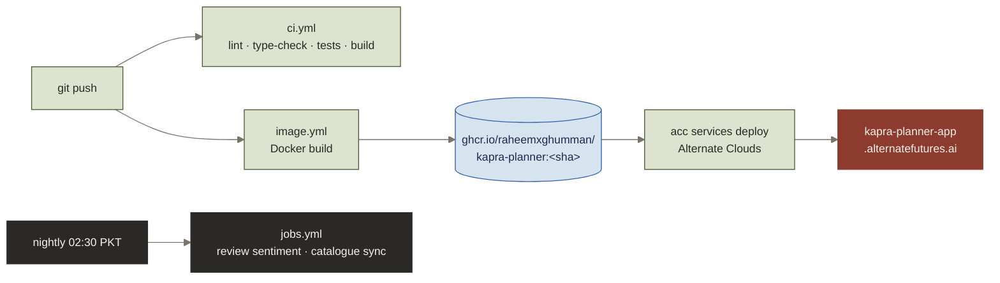

---

## Deployment on Alternate Clouds

Kapra runs as **one Docker container** on Alternate Clouds (project `kapra-planner`, 1 CPU, 1 GB, pay as you go) at **https://kapra-planner-app.alternatefutures.ai**.

1. A push to `main` runs `image.yml`, which builds `ghcr.io/raheemxghumman/kapra-planner:<commit sha>`.
2. Deploy that tag:
   ```bash
   acc services deploy kapra-planner \
     --image ghcr.io/raheemxghumman/kapra-planner:<sha> \
     --cpu 1 --memory 1Gi --spend payg -y
   ```
3. Configuration lives in the service's environment variables (`acc services env list kapra-planner`). No secrets are in the repository or the image.

> [!NOTE]
> The container applies pending migrations when it starts. Each release builds its files into `assets/<commit sha>/`, so Cloudflare (in front of Alternate Clouds) can never serve a file from an older release.

---

## Design system

An editorial, paper-and-ink look: hairline borders, Bodoni Moda italics for accents, Instrument Sans for text, and motion that eases rather than bounces.

| Token | | Use |
|---|:-:|---|
| `paper` `#ECE7DE` |  | Page background |
| `card` `#F4F1EA` |  | Panels and cards |
| `ink` `#2B2926` |  | Text and primary buttons |
| `olive` `#4F5A3A` |  | Progress, success, live states |
| `henna` `#8C3B2E` |  | Highlights, best match, alerts |
| `blush` `#E8C9C0` |  | Soft accents |
| `sand` `#D9CFBF` |  | Placeholders and image backgrounds |
| `hairline` `#CFC8BC` |  | Borders |

Animations respect the system's **reduced motion** setting.

---

## Limits and what's next

| Now | Next |
|---|---|
| Payments in Stripe **test mode**; refunds wait for approval in the Stripe dashboard | Live mode with a webhook secret |
| Receipt emails are written to the server log | Resend with the project's own domain |
| Try-on cuts long kurtas to shirt length (IDM-VTON) | FASHN VTON v1.5 (open source) as the first try-on provider for full-length outfits |
| Roman Urdu reviews are scored less reliably | Fine-tune the sentiment model on Roman Urdu reviews |
| Brands without a linked account are catalogue only (buy on their site) | Onboard brands as partners |
| `kapra-planner-app.alternatefutures.ai` address | A custom domain once Alternate Clouds supports it |

---

## Team

| | Name | Student ID |
|:-:|---|---|
| 🧑‍💻 | **Abdulraheem** | 241854 |
| 🧑‍💻 | **Wania Rahman** | 241830 |

Course **CS-301 Full Stack Web Development**, Air University Islamabad, Fall 2026 · Instructor **Sir Obaidullah**.

More detail: [build plan](docs/PLAN.md) · [backlog](docs/BACKLOG.md) · [design changes since Deliverable 2](docs/DESIGN-CHANGES.md) · [viva notes](docs/VIVA.md) · [environment](docs/ENVIRONMENT.md) · [coding conventions](docs/CONVENTIONS.md)
