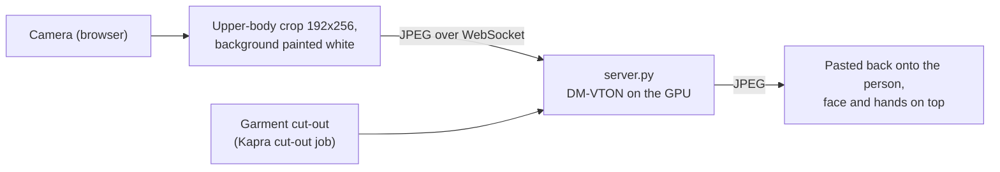

# Real-time AI try-on server

Powers **AI live** on Kapra's live try-on page (`/live/:id`). Instead of placing a flat cut-out on the camera picture, an AI model redraws the garment **onto your body** in every frame, so it follows your torso and arms and covers your own clothes.

It runs **[DM-VTON](https://github.com/KiseKloset/DM-VTON)** (Distilled Mobile Real-time Virtual Try-On, ISMAR 2023) on an NVIDIA GPU. It reaches about 40 frames a second on a T4 and runs on a laptop RTX 2070.



## Setup (once)

Needs Python 3.10+ and an NVIDIA GPU with a recent driver.

```powershell
cd realtime-tryon
python -m venv .venv
.venv\Scripts\python -m pip install torch torchvision --index-url https://download.pytorch.org/whl/cu124
.venv\Scripts\python -m pip install -r requirements.txt
.venv\Scripts\python setup.py      # clones DM-VTON (pinned commit) and downloads its weights
```

## Run

```powershell
.venv\Scripts\python server.py     # ws://localhost:8765
```

Open a live try-on page and switch on **AI live**. The page connects to `ws://localhost:8765`; another address can be set with `VITE_REALTIME_TRYON_URL` when building the website.

## How it works

| File | Job |
|---|---|
| `server.py` | WebSocket server. A text message picks the garment; each binary message is a 192x256 JPEG of the person, answered with the try-on JPEG. One frame is in flight at a time, so a slower GPU lowers the frame rate instead of adding delay. Only Kapra's own origins may connect. |
| `tryon/model.py` | Loads DM-VTON: a **warping module** predicts how to bend the flat garment to the body (an appearance flow), then a **MobileNetV2 U-Net generator** blends it into the person and repaints arms and neck. |
| `tryon/correlation.py` | The cost volume used by the warping module, in plain PyTorch. DM-VTON ships it as a CUDA kernel run through `cupy`, which needs the whole CUDA toolkit. |
| `tryon/garment.py` | Places a Kapra cut-out like a VITON product photo (centred on white, 192x256) and makes its edge mask from the transparency. |

The browser does the person-side work it already does for live AR: MediaPipe Pose picks the upper-body crop (eyes to hips, 3:4), and the multiclass segmenter paints the background white, because the model learned from studio photos.

## Limits

- **Resolution:** 192x256, so the garment looks soft when enlarged.
- **Training data:** VITON, which is mostly women's tops on plain backgrounds. Busy rooms and loose or long garments work less well.
- **Licence:** DM-VTON is CC BY-NC-SA 4.0 (academic use only). It fits a university project, not commercial use.
- **Hosting:** the server needs a GPU, so it runs on this computer for demos. It could be hosted on a GPU platform (for example Modal's free monthly credits) by allowing that address in the site's security policy.
